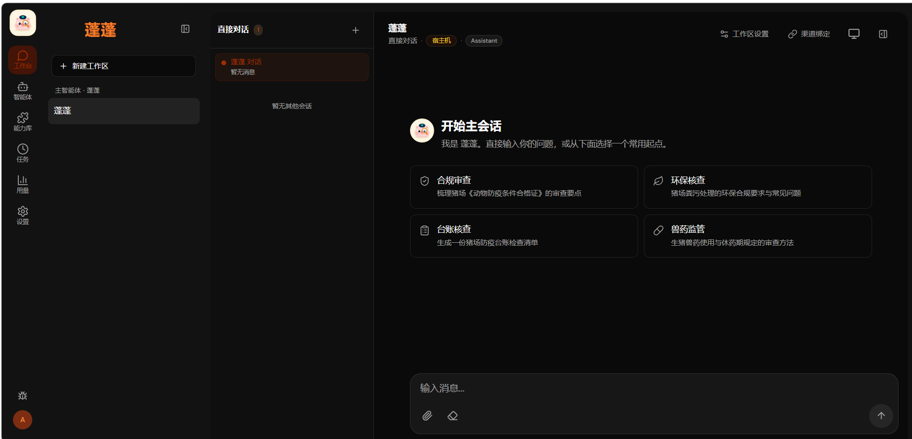
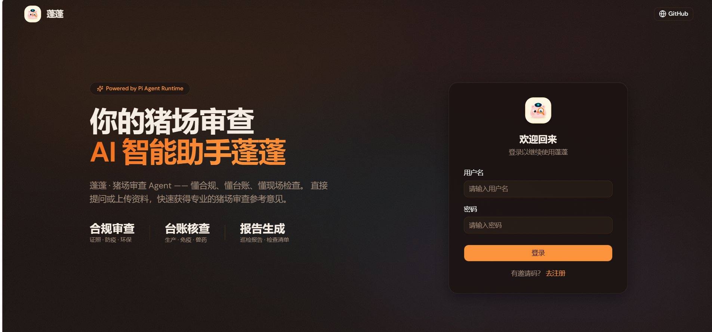

<p align="center">
  
</p>

<h1 align="center">蓬蓬 · 猪场审查 Agent</h1>

<p align="center">
  <strong>自托管、多渠道、安全隔离的猪场审查 AI 智能体</strong><br>
  懂合规 · 懂台账 · 懂现场检查
</p>

<p align="center">
  
  
  
  
  
</p>

---

**蓬蓬**是一只为猪场审查而生的 AI 智能体。它把大模型的推理能力与自托管 Agent 平台的工程能力结合在一起，帮你处理猪场审查中的高频问题：证照合规、防疫台账、粪污环保、兽药休药期、巡检报告……而你的数据始终留在自己的服务器上。

## 界面预览

<p align="center">
  
  <br>
  <sub>登录页 —— 多用户与邀请码注册机制，支持 PWA 添加到主屏幕</sub>
</p>

<p align="center">
  
  <br>
  <sub>Web 控制台 —— 主会话内置合规审查、环保核查、台账核查、兽药监管四类常用起点，左侧按工作区组织会话与智能体</sub>
</p>

## 为什么做蓬蓬

猪场审查专业性强、依据分散：《动物防疫条件合格证》、环保排污、兽药使用、免疫程序……一线人员往往需要在几十份规范文档里反复翻找。蓬蓬把这些知识装进一个随时可问的智能体里，并且在真实的工程基座上跑：

- **自托管，数据不出内网** — 后端、数据库、会话与记忆全部运行在你自己的机器上
- **多渠道接入** — 飞书、Telegram、微信、钉钉、Discord、WhatsApp、QQ，审查问答随时随地
- **沙箱隔离执行** — 需要跑代码、查数据、生成报告的任务在 Docker Agent Runner 容器中隔离运行
- **多智能体编排** — 按场景定义不同审查 Agent，各自的身份、模型、Skills、MCP 与执行策略独立管理

## 它能帮你做什么

| 场景 | 示例 |
| --- | --- |
| 合规审查 | “帮我梳理猪场《动物防疫条件合格证》的审查要点” |
| 环保核查 | “猪场粪污处理环保合规常见问题有哪些？” |
| 台账核查 | “生成一份猪场防疫台账检查清单” |
| 兽药监管 | “生猪兽药使用与休药期规定怎么审查？” |
| 报告生成 | 定时汇总台账数据，自动生成周报 / 巡检报告初稿 |
| 定时任务 | “每天早上八点把昨天的异常记录发到飞书群” |

## 核心能力

### Agent 与 Workspace

- Agent Profile 保存身份、模型、思考级别、Skills、MCP 与执行策略，猪场兽医、环保专员、场长可以各用一个 Profile
- 每个 Workspace 拥有独立的文件、Session、Memory、渠道绑定和执行边界
- Host 与 Docker 两种执行方式，需要隔离的任务放入 Agent Runner 容器运行

### 记忆与上下文

- Memory 按 Workspace 隔离，支持事实、偏好、决策与经验四类知识，带版本历史与来源回溯
- 写入使用 revision 与 compare-and-set，避免并发编辑互相覆盖
- Runtime 只注入当前 Workspace 允许使用的记忆，权限边界清晰

### Skills、MCP 与 Plugins

- 内置、宿主机、项目、用户、Workspace 与 Plugin 层级的 Skills 统一解析
- 能力库集中展示 Skills、MCP 与 Plugins 的可用状态、依赖与能力预览
- 路径穿越、符号链接逃逸、越权 Workspace 会在边界层被拒绝

### 渠道与自动化

- 消息渠道可绑定到指定 Workspace 或 Session，按用户、群聊、话题和 owner 规则做 ACL 判断
- Scheduler 支持 Cron、固定间隔与一次性任务，提供运行历史与结果投递
- 后台任务、Subagent 与渠道回复沿用同一套权限上下文

### 桌面端与移动端

- Electron Desktop 作为纯 Shell 复用 Web Client，主进程只保留窗口、菜单与受限 IPC
- Web Client 同时是 PWA，手机添加到主屏幕即可使用

## 工作原理

```text
Web Client / Electron Desktop / Message Channels
                         │ HTTP + WebSocket / Channel Adapters
                         ▼
                Pengpeng Backend
        Auth · API · Queue · Scheduler · ACL
                         │
        ┌────────────────┼─────────────────┐
        ▼                ▼                 ▼
   Workspace         Capability         Channel
   Session           Registry            Binding
   Memory            Skills/MCP          Delivery
                         │
                         ▼
                 Pi Agent Runner
                   Host / Docker
                         │
                         ▼
                Pi Agent Runtime
          Tools · Extensions · Subagents
```

核心边界保持清晰：Backend 负责认证、持久化、队列、调度、渠道和授权；Pi Runner 负责 Agent 执行；Workspace 决定文件与运行边界；Electron Renderer 只负责界面和受限的桌面桥接。

## 快速开始

### 环境要求

- Node.js 20 或更高版本
- Docker（用于沙箱化任务执行，可选但推荐）

### 启动

```bash
git clone https://github.com/LVsarff/pig-farm-review-agent.git
cd pig-farm-review-agent
make dev
```

`make dev` 会自动安装依赖、准备内置 Skills 与容器镜像，然后以开发模式启动前后端。首次启动后按日志提示初始化管理员账号（忘记密码可用 `npm run reset:admin` 重置）。

打开 `http://localhost:3000`，进入蓬蓬的 Web 控制台。

### 桌面端

```bash
make build
npm run desktop:dev        # 开发模式
npm run desktop:package    # 打包安装包
```

## 项目结构

```text
├─ src/                  # 后端服务（Auth / API / 调度 / 渠道 / ACL）
├─ web/                  # React 19 + Vite Web 控制台（PWA）
├─ electron/             # 桌面端 Shell
├─ container/agent-runner/  # Docker 沙箱执行器
├─ shared/               # 前后端共享类型
├─ config/                # 内置能力配置
├─ docs/                  # 设计文档（API / 权限矩阵 / 记忆系统）
└─ scripts/               # 工具脚本
```

## 文档

- [Web API 参考](docs/API.md)
- [权限矩阵](docs/ACL-MATRIX.md)
- [Workspace Memory 设计](docs/workspace-memory-v2.md)
- [Agent-first 架构规划](docs/agent-first-architecture-plan.md)

## 路线图

- [x] 猪场审查场景引导与多渠道问答
- [x] 定时台账核查任务
- [ ] 猪场审查知识库 Packs（证照 / 环保 / 兽药 / 防疫）
- [ ] 台账照片 OCR 结构化归档
- [ ] 巡检报告模板引擎
- [ ] 多猪场多租户管理

## 协议

本项目基于 [MIT License](LICENSE) 开源。
